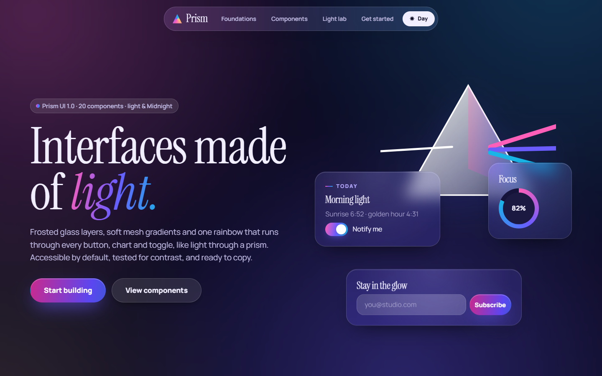

# Prism UI ✦ interfaces made of light

A design system of frosted glass, soft mesh gradients and one rainbow that runs through every button, toggle and chart, like light through a prism. Light and Midnight themes, accessible by default, and ready to copy.

**Live docs:** https://hanee2907.github.io/prism-ui/



## What's inside

- **Foundations:** colour and light (a bright spectrum for glows, a deep one wherever text sits on it), Instrument Serif and Manrope type, glass, radius, spacing and two motion curves (ease and spring).
- **20 components:** spectrum, glass, ink and ghost buttons; **Lens**, the signature glass card whose light and rainbow edge follow your cursor; chips and badges; glass and spectrum cards; text fields, selects and textareas; checkboxes, radios, switches and a segmented control; tabs; accordion; callouts; progress bar and ring; avatars; tooltip; modal; toasts; glass nav; and a light-beam divider.
- **Light lab:** pick a spectrum (Prism, Sunset, Aurora, Ocean, Bloom), roundness, frost and Day or Midnight, and the whole page follows. It deepens colours automatically wherever text sits on them, then copies your theme as CSS.
- **Every demo shows its exact code**, with a copy button.

## Accessibility

- **Contrast, tested.** 30 automated tests (Vitest) check every text and background pair in both themes against WCAG AA, using the solid colour behind the glass so text stays readable with nothing colourful behind it.
- **Two spectrums.** The bright one is only for glows, rings and toggles; buttons and badges use the deep one, where white text reaches at least 4.9:1.
- **Real elements:** native buttons, checkbox switches, `<dialog>` modals and `<details>` accordions, so keyboards and screen readers just work.
- **Visible focus** everywhere, **46px** touch targets, and a **calm motion** mode (`followSystemMotion()` turns it on from the system setting).

## Use it

```html
<link rel="stylesheet" href="https://fonts.googleapis.com/css2?family=Instrument+Serif:ital@0;1&family=Manrope:wght@400;600;700;800&display=swap">
<link rel="stylesheet" href="https://hanee2907.github.io/prism-ui/lib/prism-ui.css">

<body class="pr">
  <div class="pr-mesh"></div>
  <h1 class="pr-display">Made of <em>light.</em></h1>
  <button class="pr-btn pr-btn--spectrum">Start building</button>

  <script type="module">
    import PrismUI from 'https://hanee2907.github.io/prism-ui/lib/prism-ui.js';
    PrismUI.init(); // lens light, tabs, modals, toasts
  </script>
</body>
```

## Built with

TypeScript · CSS custom properties · Vite (docs site and library build) · Vitest

```bash
npm install
npm run dev     # docs site
npm test        # contrast tests
npm run build   # dist/ (docs) and dist/lib/ (prism-ui.css, prism-ui.js)
```

Designed and built by [Hanee Patel](https://hanee2907.github.io).
